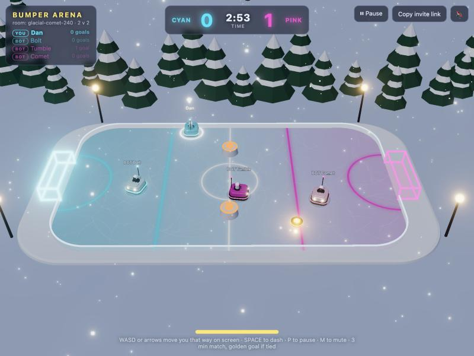
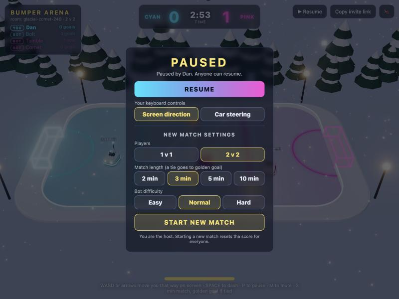

# Bumper Arena

Bumper-car hockey on a frozen lake. Grab a colleague, ram the glowing puck into the other goal, and try not to slide past it. Again.

**Play it: https://bumperarena.onrender.com**

It runs on a free server that naps when nobody is playing, so the first load can take about a minute.



## How it works

- Open the link and you get your own rink. Pick 1 v 1 or 2 v 2, then send the invite link to whoever needs humbling.
- Empty seats are filled by bots, clearly labelled so nobody can blame them unfairly.
- Matches last 3 minutes. A tie goes to golden goal.
- Works on phones too: thumb stick on the left, dash on the right.

## Controls

| | |
|---|---|
| Move | WASD or arrow keys, in the direction you want to go on screen |
| Dash | Space |
| Pause and settings | P or Esc |
| Mute | M |

Prefer to steer like an actual car? Switch to "Car steering" in the pause menu. The host can also change team size, match length and bot difficulty there.



## Run it yourself

```bash
npm install
npm start
```

Then open http://localhost:8790.

Built with three.js and a small Node WebSocket server. No accounts, no ads, just ice.
